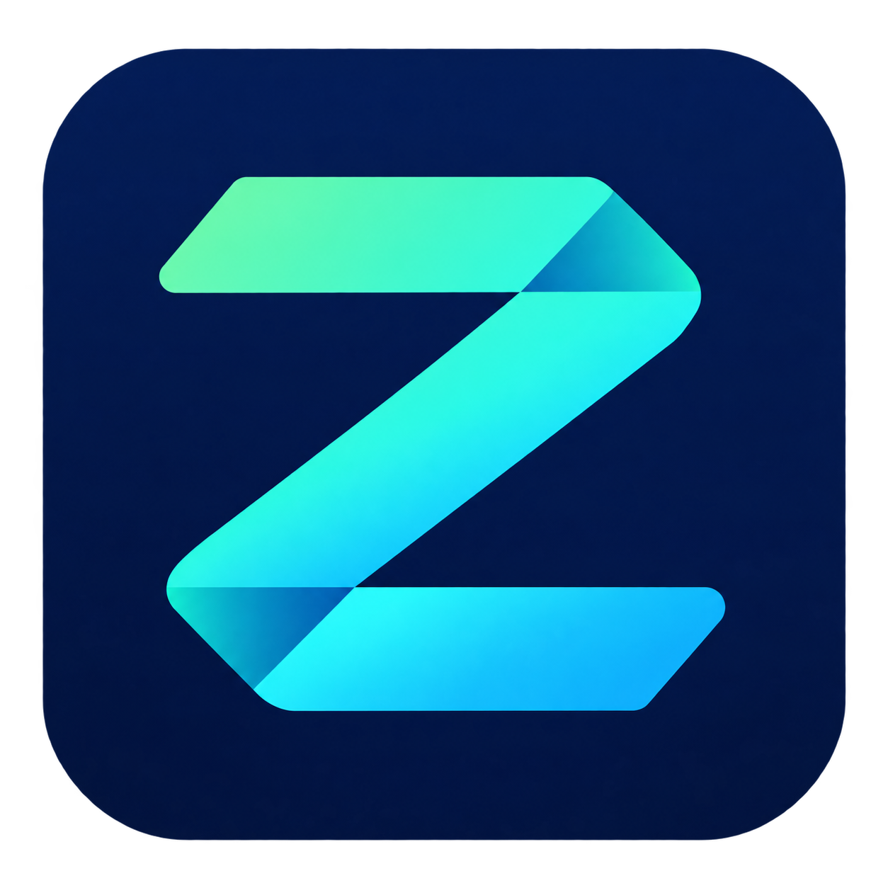

# R-Zzen



**Zzen v0.2.1** is a native C++ Windows desktop app for visual automation in Roblox **Army Commander Tycoon**. One session combines anti-AFK, construction purchases and automatic prestige, then resumes building after verifying the promotion count.

[Download v0.2.1](https://github.com/kazah-png/R-Zzen/releases/tag/v0.2.1) · [English user guide](output/pdf/Zzen-v0.2.1-User-Guide.pdf) · [Validation](VALIDACION.txt)

## License and independence

R-Zzen is an **open-source project developed and shared without a profit-making purpose**, licensed under the [MIT License](LICENSE). This describes the project's intent, not registered nonprofit status. MIT also permits commercial use by others; this statement adds no restrictions to the license.

R-Zzen is **not affiliated with, sponsored by, endorsed by, or an official product of Roblox Corporation** or the developers of Army Commander Tycoon. Third-party names, trademarks and game content belong to their respective owners. See [NOTICE.txt](NOTICE.txt).

## Getting started

1. Download and extract `Zzen-0.2.1-Windows-x64.zip` from Releases.
2. Open the tycoon and set the **game language to Spanish**. The guide explains how; Zzen's own interface is in English.
3. Close older Zzen copies and launch `Zzen.exe`.
4. Press **F8** or click **Start session**. Zzen minimizes and brings Roblox forward; keep its toolbar visible. The tested resolution is **1920 × 1080**.
5. Watch the subtle status strip at the top of the screen. Press **F8** to stop before taking manual control; press it again to start, even with Zzen minimized.

Starting a session includes automatic promotion, which resets your base and in-game cash. Zzen pauses input when Roblox loses focus and resumes when you return. Keep the computer awake and unlocked.

## Features

- Opens construction with B when a purchase notification appears and buys the game's suggested available upgrade.
- Checks promotion requirements, cost and count, handles the reset confirmation, and verifies the new count before continuing.
- Sends a keep-active jump approximately every three minutes when the game view is recognised.
- Rechecks the current More icon before clicking, including day/night toolbar movement.
- Suspends purchases on uncertain promotion outcomes and preserves a pending record across restarts. Keep-active remains eligible only on a clear game view.
- Provides a click-through status overlay, **Export log** and an optional local diagnostic.

The app uses visible screen capture, Windows OCR and normal keyboard/mouse input. It does not inject code into Roblox. It does not automate combat, premium purchases or reconnection.

## Purchase priority in v0.2.1 (27 October 2026)

- Construction runs first at startup and while purchase notifications continue. Scheduled prestige checks no longer interrupt the purchase loop.
- After 45 seconds without a purchase notification, Zzen may inspect the promotion panel. If requirements are still locked, it waits at least ten minutes before another inspection and continues buying in the meantime.
- A missing purchase notification is not evidence that every building is complete. The game must confirm its construction requirement before Zzen saves for prestige or attempts it. Once confirmed, saving checks remain about one minute apart.
- Successful purchase cycles use shorter waits, including removal of the previous eight-second pause when the game closes the menu. Fresh target checks and uncertain-purchase backoff are retained.
- A pending promotion is verified before buying resumes. Keep-active keeps its independent schedule.

Actual timing depends on OCR, game response and available money. The measured live comparison is in [VALIDACION.txt](VALIDACION.txt).

## Reliability update in v0.2 (27 October 2026)

The overnight log showed promotion 12 -> 13 followed by a construction stall: the visible `BUILD $700` button was repeatedly read as `BUILD sno`. Later, failed promotion-menu navigation stopped the entire session, including keep-active.

- An additional targeted reading handles the observed price failure and preserves building names and levels.
- Each purchase is checked again before input. The same building, level and enabled cash button must remain visible; a readable changed price cancels the action. This accounts for the game's font enlargement on hover.
- Promotion-menu targets follow the current toolbar icon, independently of changing text height on hover. Both the popup and the promotion column must be recognised again before clicking.
- Ordinary menu failures enter recovery: close a recognised panel or More menu, wait, and retry with bounded click bursts. Unknown screens never authorize blind clicks.
- Keep-active runs on a separate three-minute deadline and has priority on a recognised clear game view, including during recovery.
- Windows OCR operations have time limits and cancellation checks. F8 does not wait indefinitely for text recognition.
- Active sessions request that Windows keep the computer and display awake. Focus-loss pauses remain in place.
- Export log includes recovery, OCR-error and keep-active information. No screenshots are exported.

Uncertain transactions, unexpected confirmations and blocked screens still require attention. Purchases remain suspended; Zzen never repeats an uncertain promotion automatically. See VALIDACION.txt for the actual live-test duration and limitations. Four-hour simulations are not four-hour live runs.
## Menu reliability fix (26 October 2026)

Unclear OCR readings no longer consume the click budgets for More or Promotion. Recognition includes the observed PRECONAR/PRECIONAR variants only inside a verified popup and the expected button column. Reading can recover for up to 30 seconds; navigation remains bounded by independent click limits and a 60-second timeout.

## Feedback

Stop with **F8**, click **Export log**, and share the generated `feedback/Zzen-feedback-*.txt` with a description of the problem. Review the text before posting it publicly. Nothing is uploaded automatically. Diagnostics and screenshots remain local and are separate from the text export.

Do not delete `promocion-pendiente.txt` while a promotion outcome is uncertain: Zzen uses it to verify the previous attempt.

## Build from source

Requirements: Windows x64, Visual Studio Build Tools with **Desktop development with C++**, a Windows SDK, PowerShell and Windows OCR support for the game's text.

```powershell
.\build.ps1
.\test.ps1
.\package.ps1
```

The application is built as `native/Zzen.exe`. Packaging creates `release/Zzen-0.2.1-Windows-x64.zip`. The prebuilt English PDF is included in the repository; regenerating it requires Python, ReportLab and the Windows Segoe UI fonts:

```powershell
python .\make_english_guide.py
```

The public build passes **132 logic and synthetic-image checks**, with 22 private fixture files explicitly skipped. Private gameplay screenshots are not distributed, so their OCR regression checks are explicitly reported as skipped. A developer with the complete local fixture set can require those tests with:

```powershell
.\native\tests.exe --require-fixtures
```

## Validation and limits

The complete local suite passes **162 checks**, including the actual stalled-price and hovered-button screenshots, 1,000 promotion-panel checks, and four virtual hours with 120 repeated menu failures. Simulation time is not live gameplay time. The final executable's live-test interval, purchase evidence, keep-active events and checksum are recorded in [VALIDACION.txt](VALIDACION.txt).

Historical evidence from v0.1 includes a visually observed promotion **11 → 12** and the overnight log's verified **12 → 13**, followed by purchases. Those earlier results are not presented as a new full prestige cycle on v0.2. Promotion **13 → 14** has not been verified on v0.2.

The verified-upgrades counter can undercount purchases when the game closes the panel immediately. A closed panel alone is deliberately not treated as proof of an upgrade. UI counters restart with each session.

Version 0.2.1 targets the observed game layout and Spanish UI, including some observed English fallback text. Other resolutions and future game changes may need adjustments. This is an independent project, not affiliated with Roblox or the experience's developers.

## Source layout

| Path | Purpose |
| --- | --- |
| `cpp/core.hpp` | Recognition rules and automation state machine |
| `cpp/vision.hpp` | Image handling and Windows OCR |
| `cpp/main.cpp` | Native runtime, input checks and pending-promotion recovery |
| `cpp/ui.hpp` | English desktop interface and status overlay |
| `cpp/feedback.hpp` | Text feedback export |
| `cpp/tests.cpp` | Logic, synthetic-image and optional private-fixture regressions |
| `assets/` | Application icon and version resources |
